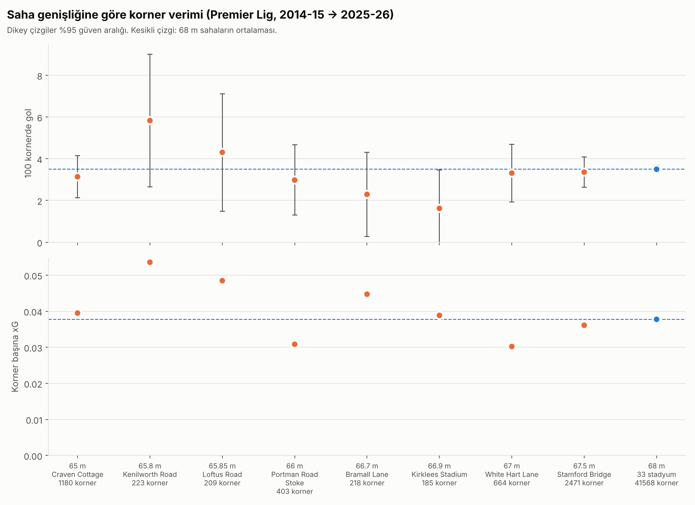
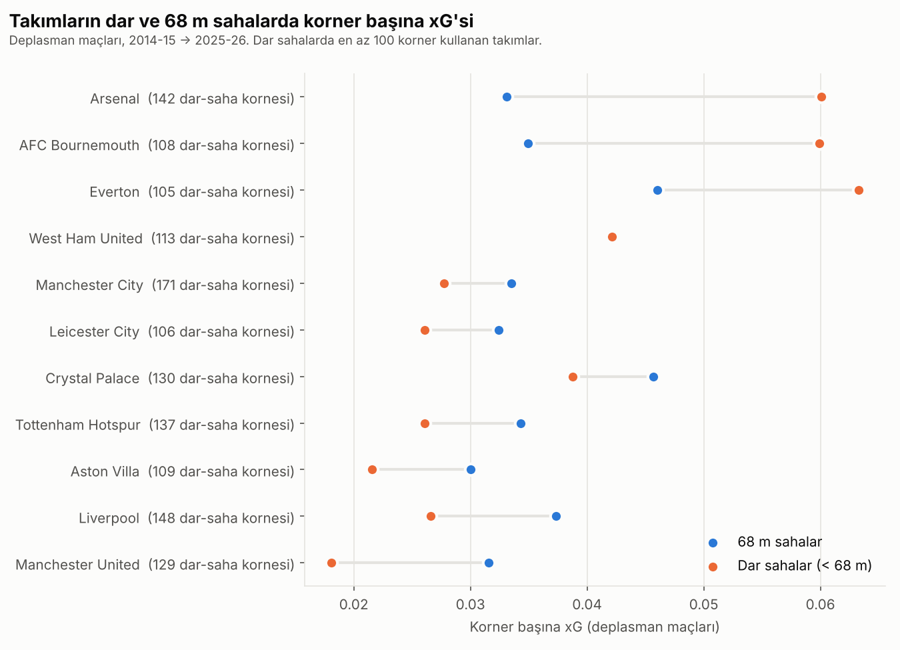

# Saha Genişliği ve Kornerler (Premier Lig)

Futbol sahasının **genişliği** kornerlerin **sayısını** ve **verimini** etkiliyor mu?
Bu proje Premier Lig verisiyle bu soruya cevap arıyor. Takım kalitesinin ve oyun tarzının etkisini ayırıp sahanın kendi etkisini görmeyi amaçlıyor.

> Durum: **ilk analiz tamamlandı** (adım 00–05). Bulgular aşağıda.

## Neden bu soru?
Veri sağlayıcılar sahayı normalleştiriyor. StatsBomb her sahayı 120 × 80, Opta 0–100 olarak gösteriyor.
Bu yüzden gerçek saha ölçüsünün etkisi standart analizlerde görünmüyor.

## Hipotezler
- **H1 (sıklık):** Geniş sahada kanat oyunu artar, dolayısıyla korner sayısı da artar.
- **H2 (verim):** Kale hep ortada, korner bayrağı ise genişliğin yarısı kadar uzakta. Geniş sahada orta uzar ve zorlaşır, korner başına şut, gol ve xG düşebilir.
- Uzunluk **kontrol değişkeni** olarak kullanılacak.

## Kapsam
- Premier Lig, **2009-10 → 2025-26** (17 sezon, yaklaşık 6.460 maç)
  - H1 (korner sayısı): 17 sezonun hepsi
  - H2 (verim, xG): 2014-15 → 2025-26 (Understat bu yıldan başlıyor)
- **Neden 2009-10'dan başlıyoruz?** 2016-17 sonrasında kulüp-sezonların yaklaşık %90'ının sahası 68 m genişlikte. Bu kadar az farkla etkiyi ölçmek zor. 2012'deki standartlaşma kuralından önce sahalar daha çeşitliydi (64–68 m). Ayrıca birkaç kulüp sahasını sonradan genişletti. Bu genişletmeler "önce-sonra" karşılaştırması için doğal deney sağlıyor.

## Veri kaynakları
| Veri | Kaynak | Not |
|---|---|---|
| Saha ölçüleri | **Premier League Handbook** (her sezonun resmi el kitabı) | Kural K.20: kulüpler ölçüyü her sezon öncesi lige kaydettirir. El kitabı bu ölçüleri yayımlar. |
| Korner sayıları | [Football-Data.co.uk](https://www.football-data.co.uk) | Maç başına ev sahibi (`HC`) ve deplasman (`AC`) kornerleri |
| Korner sonuçları | [Understat](https://understat.com) | Şutlardaki `FromCorner` etiketi ve xG |

El kitaplarının adresleri:
- 2009-10 → 2023-24: [Internet Archive koleksiyonu](https://archive.org/details/2019-20-premier-league-handbooks)
- 2024-25 ve 2025-26: premierleague.com (adresler `scripts/00_saha_olculeri.py` içinde)

### `data/stadiums.csv`
Her satır bir kulüp-sezon (340 satır).

| Sütun | Açıklama |
|---|---|
| `season`, `club`, `stadium` | Sezon, kulübün resmi adı, stadyum |
| `length_m`, `width_m` | El kitabındaki uzunluk ve genişlik (metre) |
| `status` | `resmi` = el kitabında değer var; `eksik` = el kitabında değer yok |
| `source`, `source_url`, `source_page` | Kaynak el kitabı, adresi ve PDF sayfa numarası |
| `check` | Eşleştirme kontrolü (aşağıya bak) |
| `raw_text` | El kitabındaki satırın aynısı |
| `note` | Stadyum değişikliği, eksik değer gibi notlar |

**Eşleştirme nasıl doğrulandı?** El kitabında kulüp sayfaları alfabetik sırada. Ölçüler bu sırayla kulüplere atandı. Ardından her satırda kulübün el kitabındaki web adresi kontrol edildi:
- 338 satır web adresiyle doğrulandı (`sira+web_adresi`).
- 2 satırın (Burnley 2014-15, 2016-17) metninde web adresi yok. Bu ikisi PDF sayfa içeriğinden elle doğrulandı.

**Eksik değerler (14 kulüp-sezon), boş bırakıldı ve tahminle doldurulmadı:**
- 2012-13: Chelsea, Everton, Fulham, Liverpool, QPR, Stoke, Tottenham ve West Ham'ın kutusu el kitabında boş basılmış.
- Değer olarak "TBC" ya da "To be advised" yazanlar: Birmingham 2009-10, Wolves 2009-10 → 2011-12, Burnley 2014-15, Leicester 2014-15.

**Stadyum değişiklikleri:**
- West Ham: London Stadium'a taşındı (2016-17).
- Tottenham: Wembley'de oynadı (2017-18), 3 Nisan 2019'da yeni stadyuma geçti (2018-19, sezon içinde).
- Everton: Hill Dickinson Stadium'a taşındı (2025-26).

## Proje yapısı
```
data/raw/          İndirilen ham veri (dokunulmaz; büyük el kitabı PDF'leri git'e girmez)
data/processed/    Temizlenmiş ve birleştirilmiş tablolar
data/stadiums.csv  Saha ölçüleri (kaynaklı)
scripts/           Numaralı adımlar
outputs/           Grafikler ve model sonuçları
```

## Nasıl çalıştırılır?
```bash
pip install -r requirements.txt
# PDF'leri metne çevirmek için poppler gerekir (Ubuntu: sudo apt install poppler-utils)
python scripts/00_saha_olculeri.py   # el kitaplarını indirir, data/stadiums.csv dosyasını yazar
python scripts/01_veri_indir.py      # Football-Data (17 sezon) + Understat şutları (12 sezon, ~4.560 maç, ~10-15 dk)
python scripts/02_temizle.py         # takım adlarını standartlaştırır, kaynakları eşler -> data/processed/
python scripts/03_birlestir.py       # takım-maç analiz tablosu -> data/processed/takim_mac.csv
python scripts/04_analiz.py          # genişliğe göre ve takım bazında korner verimi tabloları -> outputs/
python scripts/05_grafik.py          # grafikler -> outputs/
```

## Bulgular

Soru: **Saha genişliği, kornerden gol ve xG üretimini etkiliyor mu?**
Dönem: 2014-15 → 2025-26 (xG verisinin olduğu yıllar), yaklaşık 47.000 korner.

### 1. Genişliğe göre korner verimi


| Genişlik | Stadyum | Korner | 100 kornerde gol | Korner başına xG |
|---|---|---|---|---|
| 65 m | Craven Cottage | 1.180 | 3,1 | 0,039 |
| 65,8 m | Kenilworth Road | 223 | 5,8 | 0,054 |
| 65,85 m | Loftus Road | 209 | 4,3 | 0,048 |
| 66 m | Portman Road, Stoke | 403 | 3,0 | 0,031 |
| 66,7 m | Bramall Lane | 218 | 2,3 | 0,045 |
| 66,9 m | Kirklees Stadium | 185 | 1,6 | 0,039 |
| 67 m | White Hart Lane | 664 | 3,3 | 0,030 |
| 67,5 m | Stamford Bridge | 2.471 | 3,4 | 0,036 |
| 68 m | 33 stadyum | 41.568 | 3,5 | 0,038 |

**Yorum:** 68 m sahalarda 100 kornerin yaklaşık 3,5'i gol oluyor. Dar sahalarda bu değer 1,6 ile 5,8 arasında, ama yön tutarlı değil: bazı dar sahalarda daha yüksek, bazılarında daha düşük. Güven aralıkları neredeyse hep 68 m ortalamasını kapsıyor. Yani bu farklar şansla açıklanabilecek büyüklükte. Korner başına xG için de aynı tablo geçerli.

### 2. Takım bazında (deplasman maçları)


Dar sahalarda en az 100 korner kullanan 11 takımdan:
- 3'ü (Arsenal, Bournemouth, Everton) dar sahalarda **daha yüksek** korner başına xG üretmiş,
- 7'si **daha düşük** üretmiş,
- 1'inde (West Ham) fark yok.

Her takımın dar-saha verisi 100–170 korner. Bu kadar az kornerde gol ve xG çok oynak olur, yani tek bir takımın farkı güvenilir değil. Tüm takımlar `outputs/tablo2_takim_bazinda.csv` dosyasında.

### Sonuç (sade dille)
- Bu veride saha genişliği ile korner verimi arasında **net ve tutarlı bir ilişki görünmüyor.** Etki ya yok ya da bu veriyle görülemeyecek kadar küçük. Bu da geçerli bir sonuç.
- **Neden kesin konuşamıyoruz?** Premier Lig sahaları birbirine çok benziyor: neredeyse hepsi 68 m, en darı 65 m. Dar sahalar da birkaç stadyumda toplanıyor (Fulham, Chelsea ve birkaç kısa süreli kulüp). O stadyumlardaki sonuçlar sahadan değil, ev sahibi takımın savunmasından da gelebilir.
- **Korelasyon nedensellik değildir.** Buradaki tablolar ilişkiyi gösterir; sahanın kornerleri "değiştirdiğini" kanıtlamaz.

### Sınırlılıklar
- Saha ölçüleri kulübün lige bildirdiği resmi değerler (el kitabı); sahada bağımsız ölçüm değil.
- 14 kulüp-sezonun ölçüsü el kitabında yok; bu maçlar analiz dışı.
- Understat'in "FromCorner" etiketi, kornerden sonra gelen hücumdaki şutları kapsar.
